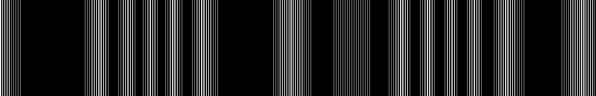

**Sound artist, research engineer, creative technologist. Marseille.**
I build generative audiovisual systems, and the tools that wire audio and image runtimes together: Max, Ableton Live, TouchDesigner, openFrameworks, VCV Rack, RNBO.

## Background

- **Art**: [sound art, installation and live performance](https://julienbayle.net) since 2010, shown in festivals and museums across Europe, the Americas and Asia.
- **Creative technologies**: research engineer in image and sound software engineering at [PRISM](https://www.prism.cnrs.fr) (CNRS / Aix-Marseille Université), on the lab's immersive platform. Native Max externals, Max for Live devices, custom hardware controllers.
- **Teaching**: Ableton Certified Trainer and Max Certified Trainer, training and consulting through [Structure Void](https://structure-void.com).
- **Books**: [The Art of Max for Live](https://leanpub.com/max-for-live-en) (Structure Void, 2025, EN/FR), *C Programming for Arduino* (Packt).

## Tools

| Ecosystem | Projects |
|---|---|
| **Ableton Link Audio** | [Void-LinkAudio](https://github.com/gluon/Void-LinkAudio), Link Audio across Max, TouchDesigner, VCV Rack, openFrameworks and Live 12.4+ [ofxAbletonLinkAudio](https://github.com/gluon/ofxAbletonLinkAudio), openFrameworks addon |
| **Max** | [void-max](https://github.com/gluon/void-max), Max/MSP/Jitter externals [void.sharedMemory](https://github.com/gluon/void.sharedMemory), shared memory contract across environments [Max Objects Network](https://structure-void.com/max-objects-network/), interactive 3D graph of the Max ecosystem |
| **Ableton Live** | [AbletonLive12_MIDIRemoteScripts](https://github.com/gluon/AbletonLive12_MIDIRemoteScripts), Live 12 MIDI Remote Scripts |

## Latest releases

<!-- releases:start -->
| Project | Release | Date |
|---|---|---|
| [void-oscq](https://github.com/gluon/void-oscq) | [v0.2.3](https://github.com/gluon/void-oscq/releases/tag/v0.2.3) | 2026-10-14 |
| [Void-LinkAudio](https://github.com/gluon/Void-LinkAudio) | [v0.3.0](https://github.com/gluon/Void-LinkAudio/releases/tag/v0.3.0) | 2026-05-15 |
| [bob-for-max](https://github.com/gluon/bob-for-max) | [v1.0.1](https://github.com/gluon/bob-for-max/releases/tag/v1.0.1) | 2026-03-14 |
| [void.sharedMemory](https://github.com/gluon/void.sharedMemory) | [v2.0.0](https://github.com/gluon/void.sharedMemory/releases/tag/v2.0.0) | 2026-02-13 |
| [jit.void.qrcode](https://github.com/gluon/jit.void.qrcode) | [1.0.1](https://github.com/gluon/jit.void.qrcode/releases/tag/1.0.1) | 2026-02-03 |
<!-- releases:end -->

## Elsewhere

[Vimeo](https://vimeo.com/julienbayle) · [SoundCloud](https://soundcloud.com/julienbayle) · [Bandcamp](https://julienbayle.bandcamp.com/) · [Instagram](https://www.instagram.com/julienbayle/)
